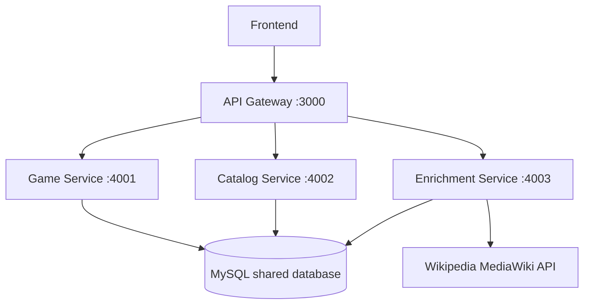

# Week 13 — Microservices Design (Pno 8)

อ้างอิง `wk13-lab.pdf` หน้า 8: ตารางอย่างน้อย 3 บริการ + diagram + รูปแบบสื่อสาร + resilience.

## การแบ่งบริการ
| บริการ | พอร์ต | ขอบเขตความรับผิดชอบ | Endpoint |
|---|---|---|---|
| Game Service | 4001 | CRUD เกมและอ้างอิง FK | `/games`, `/games/:id` |
| Catalog Service | 4002 | รายชื่อ publisher และ category | `/publishers`, `/categories` และ `/:id` |
| Enrichment Service | 4003 | ข้อมูลเสริมจาก Wikipedia | `/games/:id/background` |

API Gateway 3000 เป็นจุดรับ requests กลาง **ไม่ถือเป็นบริการธุรกิจตัวที่ 4**. ในตัวอย่างเพื่อการศึกษา บริการใช้ schema MySQL ร่วมกันจึงยังไม่เป็น service-owned databases แบบ production และใช้ authentication ผู้ดูแลหนึ่งบัญชีที่ gateway/monolith โดยบริการย่อยเข้าถึงได้เฉพาะ loopback (ไม่ใช่ระบบพร้อมเผยแพร่สาธารณะ).

## Diagram

## รูปแบบการสื่อสาร
| จาก | ไป | แบบ | เหตุผล |
|---|---|---|---|
| Frontend | Gateway | Synchronous HTTP | ต้องแสดงผลลัพธ์ทันที |
| Gateway | Game | Synchronous HTTP | ต้องรู้ผล CRUD ก่อนตอบ |
| Gateway | Catalog | Synchronous HTTP | ต้องส่งตัวเลือกบนฟอร์ม |
| Gateway | Enrichment | Synchronous HTTP | ข้อมูลเสริมตามคำขอ |
| Enrichment | Wikipedia | Synchronous HTTP | รับเนื้อหากลับทันทีและมี timeout |

ไม่มี messaging asynchronous ในเวอร์ชันนี้ เพราะยังไม่มีงาน background ที่จำเป็น.

## จุดที่ต้องมี Resilience
| ต้นทาง | ปลายทาง | กลไก | เหตุผล |
|---|---|---|---|
| Gateway | ทุก Service | Timeout 3000ms สำหรับ Game/Catalog และ 7700ms สำหรับ Enrichment เมื่อ external timeout=1800ms; 503 เมื่อเชื่อมต่อไม่ได้ | ไม่ปล่อยหน้าเว็บค้าง |
| Enrichment | Wikipedia | Retry 2 ครั้งพร้อม exponential delay, timeout 1800ms, fallback | แหล่งภายนอกไม่เสถียร |

## การรัน
`npm start` รัน process บริการทั้งสามและ Gateway; `npm run start:monolith` รัน monolith ซึ่งใช้ routes เดียวกันสำหรับ Phase 1/2.

## หลักฐานจริง
src/reports/live-results.json: Gateway 503 เมื่อปลายทางปิด และ health ยัง 200; src/tests/gateway.test.js: routing, PUT body, 404/204, malformed JSON

Gateway ไม่ retry writes อัตโนมัติ เพราะปลายทางอาจเขียนสำเร็จแล้วก่อน timeout
